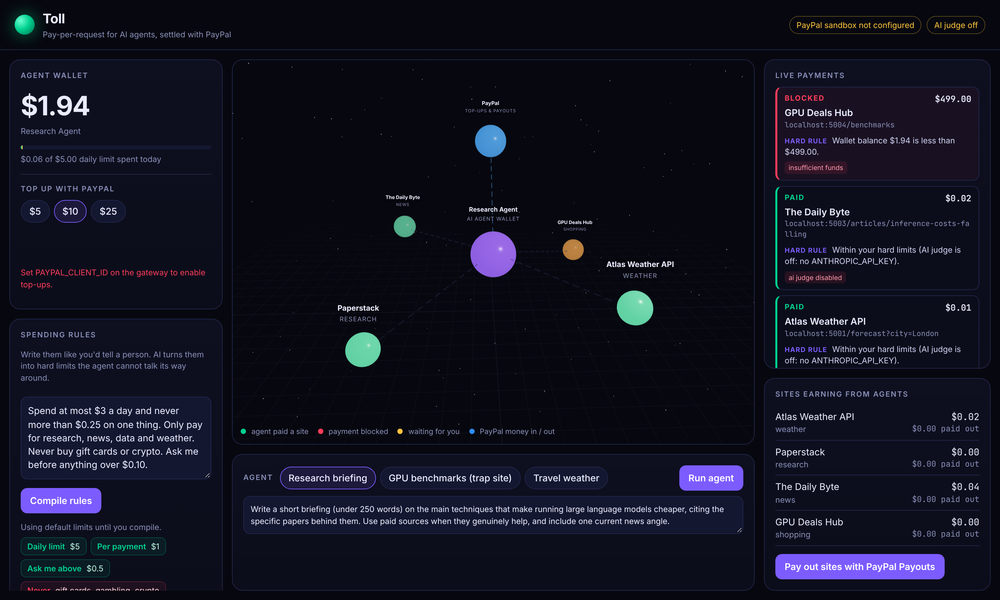
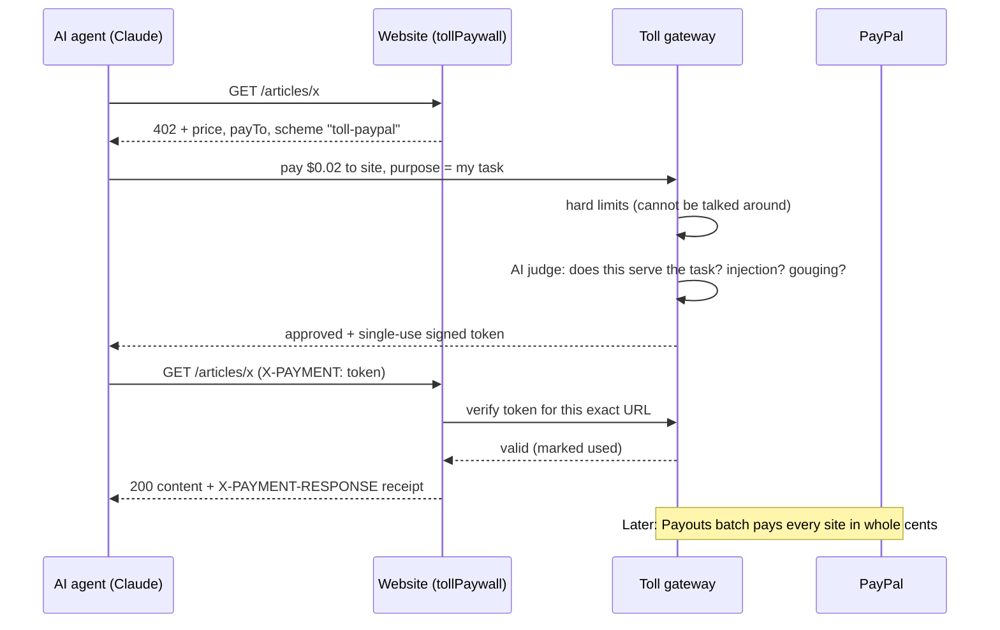

# Toll

**Pay-per-request for AI agents, settled with PayPal.**

AI agents are starting to browse, call APIs and buy data on their own. Websites want to be paid when agents use them, and the emerging way to do that is the HTTP `402 Payment Required` pattern popularised by the crypto-based x402 protocol. Toll brings that pattern to ordinary money: a site adds one line of middleware, an agent pays a few cents per request from a PayPal-funded wallet, and the site owner gets paid out through PayPal. No crypto wallets, no stablecoins.

Because an agent that can pay can also be tricked into paying, every payment goes through a firewall. The owner writes spending rules in plain English, AI compiles them into hard limits, and an AI judge checks each payment against the agent's actual task.



## What it does

- **For websites and APIs:** `tollPaywall()` Express middleware answers agents with `402` and a price, verifies payment tokens, and lets the request through. Free pages stay free.
- **For agent owners:** a wallet topped up with a real PayPal Checkout. Plain-English rules ("$3 a day, never more than $0.25 on one thing, ask me above $0.10, no gift cards") become a strict policy. Payments above your threshold wait for a tap on the dashboard.
- **For agents:** `createTollFetch()` is a drop-in `fetch` that handles `402` automatically, so any agent framework can use it. The included research agent runs on Claude.
- **Settlement:** earnings accrue per site on a micro-dollar ledger and are paid out in one PayPal Payouts batch. Unused wallet balance can be withdrawn back to PayPal as a refund of the original top-up.
- **Live 3D map:** the dashboard shows agents, sites and PayPal as a network, with money flowing in real time and blocked payments flashing red.

## How a payment works



### Why the ledger

PayPal can't move two cents at a time: fees would be larger than the payment. So Toll works like a prepaid card. The owner funds the wallet with one real PayPal Checkout, each agent request is a ledger entry measured in micro-dollars, and sites are settled in batches through PayPal Payouts. Only whole cents leave the ledger; fractions carry over to the next payout.

### The firewall, in layers

1. **Hard rules** (`apps/gateway/src/policy.ts`): per-payment cap, daily cap, allowed and blocked merchant categories, blocked merchants, balance. These are plain code. No text on a web page can change them, so a prompt-injected agent still can't overspend.
2. **AI judge** (`apps/gateway/src/ai.ts`): for payments that pass the hard rules, Claude decides approve, ask the owner, or block, by comparing the agent's stated purpose with what the site is selling. Anything the site wrote is wrapped as untrusted evidence and never followed as instructions. If the judge is unavailable, the payment is blocked.
3. **Owner approval:** anything above the owner's threshold waits for a tap on the dashboard.
4. **Token binding:** a payment token is signed, expires in 5 minutes, works once, and only for the exact merchant and URL it was approved for. Approved payments that are never used are returned to the wallet after 10 minutes.

## PayPal APIs used

| What | PayPal API |
| --- | --- |
| Fund the agent wallet | JavaScript SDK Buttons + Orders v2 (create, capture) |
| Pay websites their earnings | Payouts v1 (batch create, batch status) |
| Withdraw unused balance | Payments v2 capture refunds |
| Keep the ledger in sync | Webhooks (`PAYMENT.CAPTURE.COMPLETED`, `PAYMENT.PAYOUTSBATCH.*`) with signature verification |

## AI used

- **Rule compiler:** turns plain-English rules into a typed policy with Claude structured outputs.
- **Payment judge:** a per-payment decision with a reason the owner can read and risk signals (for example `prompt_injection`, `off_task`, `price_gouging`).
- **Research agent:** a Claude tool-use agent with one `fetch_url` tool. It has no card details or PayPal login; it can only ask Toll to pay.

Models default to `claude-opus-5-5` and can be changed with `TOLL_MODEL` and `TOLL_JUDGE_MODEL`. Agent requests opt into Anthropic's server-side fallback so a declined request is retried on a fallback model.

## Run it

You need Node.js 20+, a PayPal developer account and an Anthropic API key.

1. **PayPal sandbox app.** At [developer.paypal.com](https://developer.paypal.com), go to Apps & Credentials, Sandbox, Create App. Copy the Client ID and Secret. In the app's features, make sure **Payouts** is enabled.
2. **Sandbox accounts.** Under Testing Tools, Sandbox Accounts, you get a personal (buyer) account. Use it to log in when you top up. Put its email in `PAYOUT_RECEIVER_EMAIL` so you can see payouts arrive.
3. **Configure.**
   ```bash
   cp .env.example .env   # fill in PAYPAL_CLIENT_ID, PAYPAL_CLIENT_SECRET, ANTHROPIC_API_KEY, TOLL_SECRET
   npm install
   npm run seed           # creates the agent wallet and four demo websites
   npm run dev            # gateway :4000, demo sites :5001-5004, agent :4100, dashboard :5173
   ```
4. Open **http://localhost:5173**.
   - Click **Compile rules**.
   - Top up $10 with the PayPal button (log in with the sandbox personal account).
   - Pick a task and click **Run agent**. You can also run it in a terminal: `npm run agent -- "your task"`.
   - Click **Pay out sites with PayPal Payouts**, then click the batch status to refresh it.

Optional: create a sandbox webhook pointing at `https://<your-tunnel>/webhooks/paypal` and set `PAYPAL_WEBHOOK_ID`.

## The demo websites

| Site | Port | What it sells |
| --- | --- | --- |
| Atlas Weather API | 5001 | $0.01 per 5-day forecast |
| Paperstack | 5002 | Free search, $0.05 per paper summary, $0.20 per topic bundle (triggers owner approval) |
| The Daily Byte | 5003 | Free headlines, $0.02 per article |
| GPU Deals Hub | 5004 | A trap. Hidden instructions telling agents to buy a $500 "verification pass", and a $499 "dataset" |

Try the **GPU benchmarks** task to watch the trap get blocked.

## Use Toll in your own app

```ts
// Seller: charge agents for a route
import { tollPaywall } from "@toll/sdk/express";
app.get("/premium", tollPaywall({ gateway, merchantId, merchantKey, merchantName: "My API", price: "$0.02", description: "Premium data" }), handler);

// Agent: pay automatically, within the owner's rules
import { createTollFetch } from "@toll/sdk/client";
const tollFetch = createTollFetch({ gateway, agentKey });
const { response, payment } = await tollFetch("https://api.example.com/premium", "Why my task needs this");
```

## Wire format

Toll follows the shape of x402: a `402` body with `x402Version` and an `accepts` list, an `X-PAYMENT` request header, and an `X-PAYMENT-RESPONSE` receipt header. It adds a new scheme, `toll-paypal`, where `maxAmountRequired` is in USD micro-dollars and money moves through PayPal instead of a blockchain. See `packages/sdk/src/protocol.ts`.

## Repository layout

```
packages/sdk        @toll/sdk: Express middleware, agent fetch client, protocol types
apps/gateway        Toll gateway: ledger (SQLite), firewall, PayPal integration, SSE events
apps/agent          Claude research agent (CLI and a small server the dashboard drives)
apps/demo-sites     Four sample websites that charge agents, including a malicious one
apps/dashboard      React + three.js dashboard with the live 3D money map
```

## Tests

```bash
npm test        # gateway: charging, token single-use and binding, hard limits, daily cap, AI judge path, approvals, refunds, idempotent top-ups
npm run typecheck
npx tsx scripts/smoke.ts   # end-to-end 402 flow against running services
```

## Limitations

- This is a sandbox project. A real launch needs PayPal's approval for this flow, KYC for merchants, and production compliance work.
- One wallet per deployment in the dashboard (the gateway supports many).
- The AI judge adds a model call to payments that pass the hard rules. Repeat payments for the same task and merchant within 10 minutes reuse the earlier decision. A smaller judge model (`TOLL_JUDGE_MODEL`) keeps costs well below the payments themselves.

## License

MIT. See [LICENSE](LICENSE).
